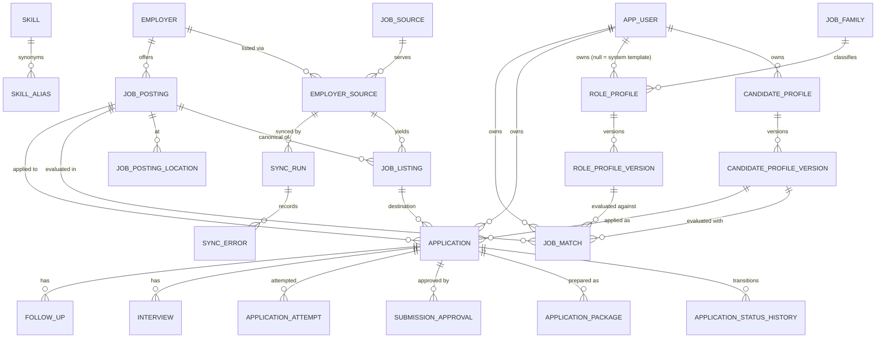

# Job Discovery & Application Platform — Architecture Proposal

> **Status: ACCEPTED (2026-10-14). Phases 1–5 (Foundation, Registry, Discovery, Candidates & Matching, Preparation) are implemented; Phases 6–9 are not.**
> Where Phase 1 deviated from the original proposal, this document was updated. See "Phase 1 outcome" in §11.

## 0. Environment (verified 2026-10-14)

| Item | Verified value | Source |
|---|---|---|
| JDK | OpenJDK 25.0.4 (LTS), Homebrew | `java -version` |
| Build | Maven 3.9.10 (Maven Wrapper will be added) | `mvn -v` |
| Spring Boot | **4.1.1** — "requires at least Java 17 and is compatible with versions up to and including Java 26" | docs.spring.io system requirements |
| Managed by Boot 4.1.1 BOM | Spring Framework 7.0.9, Hibernate 7.4.5.Final, Jackson 3.1.5, Flyway 12.4.0, Lombok 1.18.46, JUnit Jupiter 6.0.3, Mockito 5.23.0, Testcontainers 2.0.5, PgJDBC 42.7.13, Micrometer 1.17.1 | `spring-boot-dependencies-4.1.1.pom` |
| springdoc-openapi | 3.1.1 (parent: Boot 4.1.0) | Maven Central |
| Spring Modulith | 2.1.1 (Boot 4 line — *compatibility to be confirmed on first build*) | Maven Central |
| Playwright for Java | 1.63.0 | Maven Central |
| Node / npm | 22.17.1 / 10.9.2 | local |
| PostgreSQL | Homebrew PG 18 running on :5432 | `pg_isready` |
| Docker | Installed, **daemon not running** | `docker info` |

Consequences:
- We use versions managed by the Boot BOM rather than overriding them, unless there's a concrete reason.
- From JDK 23 onward, javac does **not** run annotation processors implicitly. Lombok (and any other processor) must be declared explicitly in `maven-compiler-plugin` `annotationProcessorPaths`.
- Boot 4 split auto-configuration into separate modules. Flyway needs `spring-boot-starter-flyway` plus `flyway-database-postgresql`, and Jackson 3 lives under `tools.jackson.*`.
- Compose PostgreSQL maps to host port **5433** so it doesn't clash with the Homebrew PG on 5432. The app listens on **8090** (`JOBS_PORT`), because 8080 was already taken on the development machine.
- Testcontainers requires Docker Desktop to be running.

---

## 1. Guiding decisions

1. **The system is a modular monolith in a single Spring Boot application**, with package-by-feature modules. The boundaries are checked by Spring Modulith's `ApplicationModules.verify()` in a test, so they're enforced rather than just a convention. (ADR-0001)
2. **The platform is multi-user from day one in the data model**, with authentication added later. Each user's private data is scoped to them; the employer, source and job catalog is shared. (ADR-0002)
3. **There is a stable plugin SPI in its own Maven module** (`jobs-spi`). It has no Spring or JPA dependency. Built-in plugins live in `jobs-adapters` and compile only against the SPI. (ADR-0003)
4. **Configuration is versioned YAML imported into the database.** YAML is the human-editable, git-friendly *input*. The DB is the runtime source of truth. Imports are validated, versioned and idempotent, and keyed by content hash. (ADR-0004)
5. **A candidate profile is a series of immutable versioned snapshots of facts.** Every generated claim must reference fact IDs. (ADR-0005)
6. **The application lifecycle is an explicit state machine.** Approvals are single-use and bound to the exact package content, and an uncertain submission is never retried automatically. (ADR-0006)
7. **Entities and Lombok follow written conventions.** Value objects and SPI contracts are records with `@Builder`. Entities are rich aggregates with builders, no setters and no `@Data`. (ADR-0007)

---

## 2. Maven layout and module boundaries

```
JobsApply/
├── pom.xml                      # parent/aggregator; imports Boot 4.1.1 BOM + Modulith BOM
├── mvnw, .mvn/
├── jobs-spi/                    # PLUGIN CONTRACTS ONLY: Java records/interfaces/sealed types
│   └── com.jobsapply.spi.{common,source,matching,render,application,llm}
├── jobs-app/                    # Spring Boot modular monolith (the only deployable)
│   └── com.jobsapply.
│       ├── JobsPlatformApplication
│       ├── shared/          # BaseEntity, ids, Clock, error model, json, tenancy (CurrentUser)
│       ├── identity/        # app users
│       ├── catalog/         # job families, skills + aliases (synonym normalization)
│       ├── employer/        # employer registry, CSV/YAML import
│       ├── source/          # job-source instances, employer↔source bindings, PluginRegistry
│       ├── discovery/       # sync orchestration, sync runs, freshness/availability
│       ├── posting/         # source listings, canonical postings, normalization, dedup
│       ├── roleprofile/     # versioned role profiles
│       ├── candidate/       # versioned candidate profiles + facts
│       ├── matching/        # eligibility rule chain + weighted scorers, JobMatch
│       ├── preparation/     # resume variants, cover notes, answer drafts, packages
│       ├── application/     # state machine, approvals, attempts, duplicate guards
│       ├── automation/      # browser-assisted session orchestration (uses SPI ApplicationAdapter)
│       ├── tracking/        # interviews, recruiter contacts, follow-ups
│       ├── scheduling/      # scheduled sync/match jobs, locks
│       ├── audit/           # append-only audit log (event listener)
│       └── configimport/    # YAML/CSV loading, schema-version upgrade, validation reports
├── jobs-adapters/               # built-in plugins; depends on jobs-spi only
│   └── com.jobsapply.adapters.{source.greenhouse, source.lever, source.ashby,
│                               application.playwright, render.html, llm.anthropic}
├── jobs-dashboard/              # React + TypeScript (Vite), talks to REST API only
├── config/                      # versioned YAML: job-families/, role-profiles/, employers/, sources/
├── docker/compose.yaml          # postgres:18 on host :5433
└── docs/{architecture,adr}/
```

`jobs-app` depends on `jobs-adapters` with **`runtime` scope only**, so core code can't compile against an adapter class.

### Inside a feature module (Spring Modulith conventions)

```
employer/
├── EmployerService.java          # public module API (facade), IDs + DTOs only
├── EmployerSummary.java          # public read model (record)
├── events/                       # @NamedInterface: published domain events
├── web/                          # REST controllers + request/response DTOs (OpenAPI)
└── internal/                     # entities, repositories, policies — hidden from other modules
```

Rules:
- Modules refer to each other **by ID only** (`EmployerId`), never through cross-module JPA associations. JPA associations are allowed inside a module's own aggregate.
- Cross-module side effects go through domain events. The Spring Modulith event publication registry acts as a transactional outbox, so events survive restarts.
- Controllers call module APIs and never repositories. CLI and dashboard both use the same services, so there's no duplicated logic.

### Module dependency diagram (arrows = "depends on"; no cycles)

```mermaid
flowchart LR
  subgraph Shared
    shared
  end
  identity --> shared
  catalog --> shared
  employer --> shared
  employer --> source
  source --> plugin
  plugin --> shared
  posting --> employer
  posting --> catalog
  discovery --> source
  discovery --> employer
  discovery --> posting
  roleprofile --> catalog
  roleprofile --> identity
  candidate --> identity
  candidate --> catalog
  matching --> posting
  matching --> candidate
  matching --> roleprofile
  preparation --> matching
  preparation --> application
  submission --> preparation
  submission --> application
  assist --> application
  assist --> preparation
  assist --> plugin
  tracking --> application
  operations --> discovery
  export --> candidate
  export --> preparation
  export --> tracking
  export --> audit
  resumeimport --> catalog
  resumeimport --> plugin
  tracking --> application
  operations --> discovery
  export --> candidate
  export --> preparation
  export --> tracking
  export --> audit
  resumeimport --> catalog
  resumeimport --> plugin
  scheduling --> discovery
  scheduling --> matching
  configimport --> employer
  configimport --> plugin
  configimport --> source
  configimport --> roleprofile
  configimport --> catalog
  audit -. listens to events .-> application
  audit -. listens to events .-> preparation
  audit -. listens to events .-> candidate
  SPI[(jobs-spi)]
  source --> SPI
  matching --> SPI
  preparation --> SPI
  automation --> SPI
  ADP[jobs-adapters] --> SPI
```



---

## 3. Multi-user model (summary of ADR-0002)

| Data | Ownership | Why |
|---|---|---|
| Employers, job sources, employer↔source bindings, listings, canonical postings, sync runs, skills, job families | **Shared catalog** | A vacancy exists regardless of who's looking, so sync runs once and serves every user. |
| Role profiles | **System templates** (`owner_user_id IS NULL`) **+ user-owned** profiles/forks | Sample profiles ship as templates, and each user can fork and tune their own. |
| Candidate profiles and facts, resumes, matches, applications, packages, approvals, attempts, interviews, follow-ups, contacts, employer preferences (watch/ignore) | **User-owned** (`owner_user_id NOT NULL`) | Personal data |
| Audit events | Record `actor_user_id`; filtered per user in the UI | Accountability |

**Enforcement, in layers:**
1. Strictly owned entities use Hibernate's `@TenantId` (discriminator-based multitenancy), resolved through a `CurrentTenantIdentifierResolver` backed by `UserContext`. Hibernate then adds the owner predicate to every query and sets the owner on insert.
2. Role profiles can't use `@TenantId`, because system templates have a NULL owner. They're scoped by an explicit repository query (`owner = :me OR owner IS NULL`).
3. An integration test confirms that user A can't read or modify user B's data through any repository or service.
4. Background jobs such as matching must set the user context explicitly through `UserContext.runAs(userId, ...)`, and a missing context fails fast.
5. Native SQL bypasses `@TenantId`, so it's banned in owned modules unless reviewed (ArchUnit/Modulith rule).

**Authentication:** the current user is held in `UserContext`, a Java 25 `ScopedValue` that web requests and background jobs bind. Since Phase 8 (ADR-0013), web requests bind it from a Spring Security session: local accounts with BCrypt, ADMIN/USER roles, and one-time first-account setup that takes over the pre-login `local` user. Because ownership was in the schema from the start, adding a second person needed **no** schema rework.

---

## 4. Domain model

### 4.1 Key distinctions (enforced by separate types/tables)

- **Employer ≠ JobSource.** An `EmployerSource` binding links them, so one adapter can serve many employers and one employer can have many sources.
- **JobListing ≠ JobPosting.** A listing is one source's record, unique on `(employer_source, external_id)`. A posting is the canonical vacancy; several listings can merge into one posting during dedup.
- **JobPosting ≠ Application.** Applying is a separate user-owned aggregate.
- **CandidateProfile ≠ RoleProfile.** The first describes *who I am*; the second describes *what I'm looking for*.
- **ResumeTemplate ≠ ResumeVariant.** A template is a layout plus selection rules. A variant is a generated, immutable artifact tied to a profile version and a job.
- **Prepared ≠ Approved ≠ Submitted.** These are distinct states with distinct evidence.
- **A failed sync ≠ a closed job.** A failure sets availability to `UNKNOWN`, never `CLOSED`.
- **SUBMISSION_UNCONFIRMED** blocks retries until a human verifies the outcome.

### 4.2 Entity-relationship diagram (initial)



### 4.3 Conventions for all tables
- Primary keys are `uuid`, generated by the application as **UUIDv7** (time-ordered, so they index well). The Hibernate 7 `@UuidGenerator` v7 style will be verified in Phase 1.
- Timestamps are `timestamptz`, `created_at` and `updated_at`, mapped to `Instant`, with an injected `Clock` so tests can control time.
- Mutable aggregates carry a `version bigint` for optimistic locking (`@Version`).
- Stable business keys (`employer.key`, `role_profile.key`) are lower-case slugs with `CHECK (key ~ '^[a-z0-9][a-z0-9-]{1,62}$')`.
- Enums are stored as `text` with `CHECK (col IN (...))`, not PG enum types, which are painful to migrate.
- Flexible or source-specific data goes in `jsonb` and is mapped with `@JdbcTypeCode(SqlTypes.JSON)` to **typed records**, never `Map<String,Object>` in domain code.
- **Deletion behavior:**
  - Catalog rows are disabled or archived (`enabled=false`, `archived_at`), never hard-deleted, because postings and applications reference them.
  - Postings and listings are never deleted, since they're history.
  - User-owned rows use `ON DELETE CASCADE` from `app_user`, so a user's personal data can be deleted completely.
  - `audit_event` has no foreign key to users, and its actor is pseudonymized on user deletion.

### 4.4 Initial schema (Flyway `V1__…` through `V6__…`, Phase 1)

PostgreSQL-specific features used: `jsonb`, partial unique indexes, `UNIQUE NULLS NOT DISTINCT` (PG15+), and `CHECK` constraints.

**identity**
- `app_user(id, username UNIQUE, display_name, email UNIQUE NULL, status CHECK(ACTIVE|DISABLED), created_at, updated_at, version)`

**catalog**
- `job_family(id, key UNIQUE, display_name, description, created_at, updated_at)`
- `skill(id, key UNIQUE, display_name, category)`
- `skill_alias(id, skill_id FK, alias_normalized UNIQUE)`: one alias maps to exactly one skill.

**employer / source**
- `employer(id, key UNIQUE, display_name, normalized_name, website_url, careers_url, industry, tags text[], headquarters, metadata jsonb, enabled, discovery_priority int CHECK 0..100, archived_at, created_at, updated_at, version)`, indexed on `(enabled, discovery_priority)` and with a GIN index on `tags`
- `job_source(id, key UNIQUE, adapter_id, display_name, enabled, settings jsonb, settings_schema_version int, created_at, updated_at, version)`: a configured *instance* of an adapter plugin.
- `employer_source(id, employer_id FK, job_source_id FK, external_ref text /* board token / site */, enabled, priority, settings jsonb, last_success_at, last_failure_at, consecutive_failures int, last_error text, created_at, updated_at, version)`, `UNIQUE(job_source_id, external_ref)`
- `user_employer_preference(owner_user_id, employer_id, mode WATCH|IGNORE, priority)` was deferred to Phase 2.

**discovery / posting**
- `sync_run(id, job_source_id FK, employer_source_id FK NULL, trigger CHECK(MANUAL|SCHEDULED), dry_run, status CHECK(RUNNING|SUCCEEDED|PARTIAL|FAILED|ABORTED), started_at, finished_at, discovered, inserted, updated, unchanged, marked_closed, failed int…)` with a **partial unique index** on `(employer_source_id) WHERE status='RUNNING'`, which prevents concurrent syncs of the same board at the database level.
- `sync_error(id, sync_run_id FK, kind CHECK(TRANSIENT|RATE_LIMITED|AUTH|NOT_FOUND|PARSE|PERMANENT), external_ref, message, occurred_at)`
- `job_posting(id, employer_id FK, title, title_normalized, seniority, employment_type, workplace_type CHECK(REMOTE|HYBRID|ONSITE|UNKNOWN), salary_min, salary_max, salary_currency, salary_period /* only when supplied */, description_text, dedup_fingerprint, availability CHECK(OPEN|CLOSED|UNKNOWN), first_seen_at, last_seen_at, created_at, updated_at, version)`, with an index on `(employer_id, dedup_fingerprint)`
- `job_posting_location(id, job_posting_id FK CASCADE, raw_text, city, region, country_code, is_remote)`
- `job_listing(id, employer_source_id FK, job_posting_id FK, external_id, title_raw, location_raw jsonb, department, employment_type_raw, listing_url, application_url, published_at NULL, source_updated_at NULL, first_seen_at, last_seen_at, last_checked_at, availability, availability_evidence jsonb, content_hash, source_metadata jsonb, created_at, updated_at, version)`, **`UNIQUE(employer_source_id, external_id)`**, which is what makes upserts idempotent.

**role profiles**
- `role_profile(id, owner_user_id FK NULL, job_family_id FK, key, display_name, active_version_id NULL, archived_at, …)`, **`UNIQUE NULLS NOT DISTINCT (owner_user_id, key)`**
- `role_profile_version(id, role_profile_id FK, version_no, schema_version, definition jsonb, content_hash, created_at)`, `UNIQUE(role_profile_id, version_no)` and `UNIQUE(role_profile_id, content_hash)`, so re-importing the same YAML is a no-op.

**candidate**
- `candidate_profile(id, owner_user_id FK, key, display_name, current_version_id NULL, archived_at, …)`, `UNIQUE(owner_user_id, key)`
- `candidate_profile_version(id, owner_user_id, candidate_profile_id FK, version_no, schema_version, snapshot jsonb, content_hash, note, created_at)`, `UNIQUE(candidate_profile_id, version_no)`. Rows are immutable (enforced in code, plus a trigger that rejects UPDATE).
- `resume_template` and `master_resume` were deferred to Phase 5, which is when they're first used.

**matching**
- `job_match(id, owner_user_id, job_posting_id, candidate_profile_version_id, role_profile_version_id, strategy_key, strategy_version, score numeric(5,2) NULL, eligibility CHECK(ELIGIBLE|NOT_ELIGIBLE|UNKNOWN), result jsonb, evaluated_at)`, **`UNIQUE(owner_user_id, job_posting_id, candidate_profile_version_id, role_profile_version_id, strategy_key, strategy_version)`**, so re-evaluating is idempotent.

**application**
- `application(id, owner_user_id, job_posting_id, job_listing_id, candidate_profile_id, candidate_profile_version_id, role_profile_version_id, job_match_id NULL, status, status_changed_at, created_at, updated_at, version)`
  - **Partial unique index `(owner_user_id, job_posting_id) WHERE status IN ('APPROVED','SUBMITTING','SUBMITTED','SUBMISSION_UNCONFIRMED')`.** Only one live or submitted application per user per canonical vacancy is allowed, no matter which candidate profile or source listing is used. This is the database-level duplicate-submission guard.
  - Partial unique `(owner_user_id, job_posting_id, candidate_profile_id) WHERE status NOT IN (terminal states)`, which stops duplicate drafts.
- `application_status_history(id, application_id FK, from_status, to_status, actor_type CHECK(USER|SYSTEM), actor_user_id NULL, reason, occurred_at)`. Append-only.
- `application_package`, `submission_approval`, and `application_attempt` are specified in §7 and land in Phases 5–6.

**audit**
- `audit_event(id, occurred_at, actor_type, actor_user_id NULL, aggregate_type, aggregate_id, event_type, correlation_id, payload jsonb /* redacted */)`, indexed on `(aggregate_type, aggregate_id, occurred_at)`. Append-only: the app DB role gets no UPDATE/DELETE grant on it in production setups.

**Spring Modulith**'s `event_publication` table arrives with the first cross-module event (Phase 2/3) as its own Flyway migration.

---

## 5. Plugin SPI (`jobs-spi`): contracts

All contracts use Java 25 records, sealed result types and `@Builder` (Lombok is `provided` scope, so it isn't a runtime dependency for plugin authors). **SPI types never contain JPA entities, and core domain types never contain provider payloads.**

### 5.1 Common

```java
public record PluginDescriptor(
    String id,                    // "greenhouse-job-board" — stable, unique
    String version,               // plugin implementation version
    PluginKind kind,              // JOB_SOURCE, MATCHING, RENDERER, APPLICATION, LLM
    Set<Capability> capabilities,
    Class<? extends PluginSettings> settingsType,   // validated with Bean Validation
    int settingsSchemaVersion,
    ComplianceNote compliance) {} // documented endpoint URL, ToS notes, auth required?

public interface Plugin { PluginDescriptor descriptor(); }

public sealed interface PluginResult<T> {
  record Ok<T>(T value) implements PluginResult<T> {}
  record Failed<T>(FailureKind kind, String message, Duration retryAfter) implements PluginResult<T> {}
  record Unsupported<T>(Capability capability) implements PluginResult<T> {}
}
public enum FailureKind { TRANSIENT, RATE_LIMITED, AUTH, NOT_FOUND, PARSE, PERMANENT }
```

**Registration (Registry pattern + Spring DI):**
- Every plugin is a Spring bean that implements a kind-specific interface.
- `PluginRegistry<T extends Plugin>` collects `List<T>` from the context, rejects duplicate IDs at startup (fail fast), checks each descriptor, and keeps only plugins listed in `jobs.plugins.enabled`. That allow-list is what makes registration explicit.
- Third-party plugins ship as a JAR with a Spring Boot `AutoConfiguration.imports` entry. Core code doesn't change.
- Callers check `descriptor().capabilities()` before invoking an operation. A plugin that's called for an unsupported capability returns `Unsupported` rather than throwing.

### 5.2 Job source adapters

```java
public interface JobSourceAdapter extends Plugin {
  ValidationReport validateConfiguration(SourceBinding binding);           // board token, settings
  PluginResult<DiscoveryPage> discoverJobs(DiscoveryRequest request);       // one page; cursor-based
  PluginResult<SourceJob> fetchJobDetails(SourceJobRef ref);
  PluginResult<AvailabilityObservation> checkAvailability(SourceJobRef ref);// OPEN / CLOSED / UNKNOWN + evidence
  HealthReport healthCheck(SourceBinding binding);
}
// Capability: LIST_JOBS, JOB_DETAILS, AVAILABILITY_CHECK, INCREMENTAL_SYNC,
//             COMPENSATION, APPLICATION_QUESTIONS, APPLY_VIA_API
public record DiscoveryRequest(SourceBinding binding, String cursor, int pageSize, Instant modifiedSince) {}
public record DiscoveryPage(List<SourceJob> jobs, String nextCursor, boolean complete) {}
public record SourceJob(String externalId, String title, List<RawLocation> locations, String department,
    String employmentTypeRaw, String descriptionHtml, URI listingUrl, URI applicationUrl,
    Instant publishedAt /* null if not supplied */, Instant updatedAt /* null if not supplied */,
    Compensation compensation /* null if not supplied */, Map<String, JsonValue> sourceMetadata) {}
```

- **Template Method:** `AbstractHttpJobSourceAdapter` owns timeouts, bounded retry with backoff (honoring `Retry-After`), per-host rate limiting, response-size limits and metrics. Subclasses implement only `buildPageRequest()` and `parsePage()`. Provider parsing stays inside the adapter.
- **The availability rule lives in the core, not the adapter.** Only an *authoritative* signal from the source, such as a 404 or absence from a *complete* listing, may move a listing to `CLOSED`. Transport or parse failures produce `UNKNOWN`.
- **Initial adapters (Phase 3).** Each endpoint will be re-verified against official docs before implementation:
  - Greenhouse Job Board API: `boards-api.greenhouse.io/v1/boards/{token}/jobs`
  - Lever Postings API: `api.lever.co/v0/postings/{site}`
  - Ashby public posting API: `api.ashbyhq.com/posting-api/job-board/{name}`
  - All three are *listing* APIs. Their descriptors will **not** declare `APPLY_VIA_API`.

### 5.3 Matching (Strategy + Chain of Responsibility + Factory)

```java
public interface EligibilityRule extends Plugin {              // hard constraints
  RuleOutcome evaluate(MatchContext ctx, RuleParams params);   // PASS | FAIL | UNKNOWN + evidence
}
public interface ScoreComponent extends Plugin {               // soft preferences
  ComponentScore score(MatchContext ctx, ComponentParams params); // 0..1 + matched/missing + reasons
}
public interface MatchingStrategy extends Plugin {             // composes the above
  MatchResult evaluate(MatchContext ctx, StrategyConfig config);
}
public record MatchContext(JobSnapshot job, CandidateSnapshot candidate, RoleProfileDefinition role) {}
public record MatchResult(String strategyKey, String strategyVersion, BigDecimal score,
    Eligibility eligibility, List<Requirement> matched, List<Requirement> missing,
    List<Disqualifier> disqualifying, List<UncertainFact> uncertain, List<String> reasons) {}
```

- Rule and component types are **data-driven**. Role-profile YAML names them (`type: min-experience-years`), and a `RuleFactory` looks the type up in the registry and binds the params.
- **The Chain of Responsibility evaluates every rule; it doesn't short-circuit**, so the explanation is complete. Eligibility is `NOT_ELIGIBLE` if any rule FAILs, `UNKNOWN` if any is UNKNOWN and none FAIL, and `ELIGIBLE` otherwise.
- **The LLM is structurally barred from eligibility decisions.** An `LlmProvider`-backed component can only implement `ScoreComponent`, its weight is capped by config, and the strategy is fully functional with the LLM disabled.

### 5.4 Preparation (resume, cover note, answers)

```java
public interface ResumeContentGenerator extends Plugin {       // what to say
  ResumeDocument generate(MatchContext context, ResumeTemplateDefinition template); // context carries job, candidate version + snapshot, role
}
public interface DocumentRenderer extends Plugin {             // how it looks
  RenderedDocument render(ResumeDocument doc, RenderOptions opts); // HTML, PDF, DOCX…
}
public interface AnswerDrafter extends Plugin {
  AnswerDraft draft(ApplicationQuestion question, MatchContext context);
}
public record Claim(String text, List<FactRef> sources) {}   // every claim cites facts
```

A core `ClaimTraceabilityValidator` rejects any `ResumeDocument` or answer containing a claim with no `FactRef`, or with a reference to a fact that isn't `VERIFIED` or user-approved. Answers covered by an `ALWAYS_ASK_USER` policy (for example sponsorship, salary or notice period without a fact) are left as **unanswered** and are never guessed.

### 5.5 Application adapters (browser-assisted)

```java
public interface ApplicationAdapter extends Plugin {
  boolean supports(ApplicationDestination destination);        // e.g. greenhouse-hosted form
  PluginResult<FormInspection> inspect(ApplicationSession s);   // discovered fields + types
  PluginResult<FillReport> fill(ApplicationSession s, FieldMappingPlan plan); // HIGH-confidence only
  PluginResult<ValidationReport> validate(ApplicationSession s);
  PluginResult<ConfirmationEvidence> observeConfirmation(ApplicationSession s, Duration timeout);
}
```

- **No unattended `submit()` exists in the SPI.** By default the human clicks Submit in the visible (headed) browser, and the adapter only *observes* the confirmation.
- If an adapter-clicked submission is ever added, it must take a single-use `SubmissionApprovalToken`, which the core consumes transactionally.
- Adapters must stop and hand control back to the user when they detect CAPTCHA, MFA or a login wall. They never try to bypass these.

### 5.6 LLM provider

```java
public interface LlmProvider extends Plugin {
  PluginResult<LlmResponse> complete(LlmRequest request); // request carries redaction policy
}
```

The default is `none`. The Anthropic provider is optional and added in a later phase. All callers must handle the provider being absent.

---

## 6. Configuration formats (versioned YAML → DB)

All files carry `schemaVersion` and `kind`. The importer works like this:
- **Parse.** Jackson 3 YAML is read into typed records.
- **Upgrade.** A chain of `ConfigUpgrader`s, one per version, brings older schema versions forward.
- **Validate.** Bean Validation runs, followed by semantic checks: skill keys exist, rule types are registered, weights sum to 1.0, thresholds are ordered.
- **Report.** Errors are reported as `file:path.to.field: message`.
- **Upsert.** The importer upserts by `key` and `content_hash`. Unchanged content produces no new version.
- **Dry run.** `--dry-run` validates without writing anything.

**`config/sources/greenhouse-public.yaml`**
```yaml
schemaVersion: 1
kind: JobSource
key: greenhouse-public
adapter: greenhouse-job-board          # plugin id from PluginDescriptor
enabled: true
settings:
  requestTimeout: PT10S
  maxRetries: 3
  rateLimit: { permits: 5, per: PT1S }
```

**`config/employers/example-employers.yaml`** (CSV import/export is supported with equivalent columns)
```yaml
schemaVersion: 1
kind: EmployerSet
employers:
  - key: example-fintech
    displayName: Example Fintech Inc.
    website: https://example.com
    careersUrl: https://example.com/careers
    industry: fintech
    tags: [fintech, payments]
    discoveryPriority: 80
    enabled: true
    sources:
      - source: greenhouse-public
        externalRef: examplefintech      # board token
      - source: lever-public
        externalRef: examplefintech      # site name
```

**`config/role-profiles/backend-engineer.yaml`** (an illustrative example, *not* the candidate's verified qualifications)
```yaml
schemaVersion: 1
kind: RoleProfile
key: backend-engineer
displayName: Backend Engineer / SDE
jobFamily: backend
example: true
titles:
  include: [backend engineer, software engineer, sde, software development engineer, platform engineer]
  exclude: [frontend, ios, android, engineering manager, intern]
  seniority: [ENTRY, MID, SENIOR]
searchTerms: [backend, java, distributed systems, microservices]
skills:
  required: [java]
  requiredAnyOf: [[sql, postgresql, mysql]]
  preferred:
    - { skill: spring-boot, weight: 2 }
    - { skill: kafka, weight: 1 }
    - { skill: kubernetes, weight: 1 }
    - { skill: aws, weight: 1 }
experience: { minYears: 1, maxYears: 8 }
locations:
  workplaceTypes: [REMOTE, HYBRID, ONSITE]
  preferred: []                          # e.g. [{ country: XX, city: Example City }]
employmentTypes: [FULL_TIME]
eligibility:                             # HARD — any FAIL ⇒ NOT_ELIGIBLE, any UNKNOWN ⇒ UNKNOWN
  - type: title-match
  - type: employment-type-in
  - type: max-required-experience
    params: { years: 8 }
  - type: work-authorization             # evaluated against candidate facts; UNKNOWN if absent
    params: { source: job-location }
scoring:                                 # SOFT
  strategy: weighted
  strategyVersion: 1
  weights: { title: 0.20, required-skills: 0.30, preferred-skills: 0.20, experience: 0.15, location: 0.15 }
  thresholds: { minimum: 50, shortlist: 70 }
documents:
  resumeTemplate: one-page-technical
  coverNote: { strategy: none }
screeningQuestions:
  - { match: "(?i)sponsor|visa|work authori[sz]ation", policy: ALWAYS_ASK_USER }
  - { match: "(?i)salary|compensation expectation", policy: ALWAYS_ASK_USER }
  - { match: "(?i)years of (professional )?experience", policy: FROM_FACT, fact: experience.totalYears }
```

**`quant-developer.yaml`** follows the same schema with different criteria: the title includes `quant developer, quantitative developer, trading systems engineer`; the required skills are `[cpp]`, with `requiredAnyOf: [[python, java]]`; the preferred skills are `probability`, `statistics`, `algorithms`, `low-latency` and `linux`; the weights put `requiredSkills` at 0.35; and the eligibility rules may include `education-field-in` (`[computer-science, mathematics, physics, statistics]`) as **UNKNOWN-tolerant**.

**`data-engineer.yaml`**: the required skills are `[sql]` and `requiredAnyOf: [[python, scala, java]]`; the preferred skills are `spark`, `airflow`, `kafka`, `dbt` and `snowflake`.

**`config/job-families/*.yaml` and `config/skills/*.yaml`**: these are the families, the skills and their aliases (`c++ → cpp`, `postgres → postgresql`, `k8s → kubernetes`).

Candidate profiles are **not** stored in `config/`, since that's a git-tracked folder. They're imported from a file the user supplies, outside the repo or in a git-ignored `local/` directory. Uncertain imported facts come in as `UNVERIFIED` until the user confirms them.

---

## 7. Application state machine and safety (summary of ADR-0006)

| State | Meaning |
|---|---|
| DISCOVERED | An application candidate exists for (user, posting); nothing has been evaluated yet. |
| MATCHED | A match has been evaluated and the posting is above the minimum threshold. |
| NOT_ELIGIBLE* | A hard eligibility rule failed. Terminal unless re-evaluated. |
| PREPARED | A package has been generated (resume variant, answers, warnings). |
| READY_FOR_REVIEW | The package passed validation and availability was rechecked as OPEN. |
| APPROVED | The user approved *this exact package hash* for submission. |
| SUBMITTING* | The submission is in progress (durably recorded *before* the browser action). |
| SUBMITTED | Credible confirmation evidence was recorded. |
| SUBMISSION_UNCONFIRMED | The outcome is unknown. **Retry is blocked** until a human verifies it. |
| FAILED | A definite, evidenced failure (e.g. the form rejected the input); can return to PREPARED. |
| EXPIRED | The source authoritatively reports the posting closed. |
| REJECTED_BY_USER* / WITHDRAWN* | User decisions. |

\* These are additions to the requested list. They're proposed for approval (see the questions at the end).

**Transitions** are an explicit `EnumMap<Status, Set<Status>>` table in the domain, plus guard objects. Spring Statemachine is rejected as too heavy for this. `Application.transitionTo(target, actor, reason)` validates the move, writes `application_status_history`, and publishes `ApplicationStatusChanged`, all in one transaction under optimistic locking.

**Submission safety invariants:**
1. `READY_FOR_REVIEW → APPROVED` creates a `submission_approval(application_id, package_hash, approved_by, approved_at, consumed_at NULL)`, with a partial unique index that allows only one unconsumed approval.
2. `APPROVED → SUBMITTING` consumes the approval in the same transaction and records an `application_attempt` with a unique idempotency key. *Every* submission needs a fresh approval, so a batch can never auto-advance.
3. If the app crashes while SUBMITTING, startup recovery moves the application to `SUBMISSION_UNCONFIRMED`. It is **never** retried automatically.
4. `SUBMITTED` requires `ConfirmationEvidence`, such as confirmation-page text or URL, a confirmation-email reference, or a screenshot file reference. If there's none, the application goes to `SUBMISSION_UNCONFIRMED`.
5. `SUBMISSION_UNCONFIRMED → SUBMITTED | FAILED` happens only through a manual verification action that records who verified it and how.
6. The partial unique index on `application` (§4.4) blocks a second live or submitted application to the same canonical posting at the database level.

---

## 8. Cross-cutting design

| Concern | Approach |
|---|---|
| **Patterns (only where they earn it)** | Strategy (matching, renderers, drafters), Registry/Plugin (SPI), Template Method (HTTP source adapter), Adapter (ATS and Playwright), Chain of Responsibility (eligibility rules), Factory (rule and strategy creation from config), Builder (Lombok, for value objects and aggregates), State (application transition table), Observer (domain events via Spring/Modulith), Transactional Outbox (Modulith event registry), Specification (posting search filters). |
| **Errors** | RFC 9457 `ProblemDetail` from `@RestControllerAdvice`. The domain uses a typed exception hierarchy (`DomainRuleViolation`, `NotFound`, `ConcurrencyConflict`, `InvalidTransition`), and plugins return sealed results instead of throwing. |
| **Validation** | Bean Validation on API DTOs and config records, plus semantic validators. The DB also enforces constraints as a backstop. |
| **Transactions** | Defined at the application-service level. Network I/O is **never** done inside a DB transaction: a sync fetches a page, then persists it in a short transaction. |
| **Concurrency** | Optimistic locking on aggregates. A sync uses DB-level single-flight (the partial unique index on `RUNNING`). Upserts use `ON CONFLICT` semantics through the unique keys. |
| **HTTP client** | Spring `RestClient` over the JDK `HttpClient` with explicit connect and read timeouts. Retry uses Spring Framework 7's built-in resilience support (`RetryTemplate`/`@Retryable`, *to be verified in Phase 3*), bounded and with jitter. Rate limiting is a small per-host token bucket. Resilience4j isn't needed yet. |
| **Logging** | Boot's structured JSON console logging (ECS or logstash format). PII and secret redaction happens in a custom structured-log customizer, plus a rule that entities never get `@ToString`. A test checks that known PII fixtures never appear in log output. |
| **Secrets** | Never stored in the DB or YAML. Only references are stored (`secretRef: env:GREENHOUSE_HARVEST_KEY`) and resolved through a `SecretResolver`. No browser passwords or cookies are persisted, and Playwright uses an ephemeral context by default. |
| **PII at rest** | In Phase 4, sensitive candidate fields (contact details, work authorization) are encrypted at column level with a JPA `AttributeConverter` and an AES-GCM key from the environment. Data export and backup cover `pg_dump` plus a JSON export per user. |
| **Observability** | Actuator health (including source health), Micrometer counters for discovered, inserted, updated, unchanged, closed and failed jobs per source, and a correlation ID per request or sync run. |
| **API** | Versioned `/api/v1/**`, OpenAPI through springdoc, cursor or page pagination, and an `Idempotency-Key` header on mutating batch endpoints. |

---

## 9. Security and privacy risks

| Risk | Mitigation |
|---|---|
| Cross-user data leakage (multi-user) | `@TenantId` filter, explicit scoping for role profiles, an isolation test suite, and a ban on native SQL in owned modules. |
| PII in logs, exceptions or audit payloads | Redacting log customizer, no entity `toString`, redacted audit payloads, and log-scanning tests. |
| Secrets in git | `.gitignore` covers `local/`, `.env` and `*.key`; config holds secret *references* only. A gitleaks pre-commit hook is optional. |
| Fabricated claims in resumes or answers | Claim → FactRef traceability validator, `ALWAYS_ASK_USER` policies, and the LLM can't touch facts. |
| Accidental duplicate or blind submission | DB partial unique index, single-use approvals bound to the package hash, and SUBMITTING → UNCONFIRMED recovery. |
| ToS or anti-bot violations | Documented public endpoints only, compliance notes in each descriptor, rate limits, headed browser with a human in the loop, and a hard stop on CAPTCHA, MFA or login walls. |
| SSRF through configurable URLs | Adapters build URLs from templates plus validated tokens. Arbitrary base URLs aren't allowed without an allow-list. |
| Malicious HTML in job descriptions (dashboard XSS) | Store raw HTML and render sanitized text (jsoup safelist); React never uses `dangerouslySetInnerHTML` on raw HTML. |
| Uploaded resumes and documents | Stored outside the repo under a configured data directory, with path traversal prevented by generated file names and size and type limits. |
| Local dashboard exposed on a LAN | Bind to `127.0.0.1` by default; auth required once multi-user login lands. |

---

## 10. Phased plan

Each phase ends the same way: `./mvnw verify` (and `npm test` once a dashboard exists) is green, the diff is reviewed, docs and ADRs are updated, results are reported, and **work stops for approval**.

| Phase | Scope | Acceptance highlights |
|---|---|---|
| **1. Foundation** | See §11 | See §11 |
| **2. Employer & source registry** | Employer CRUD + REST + OpenAPI; YAML/CSV import and export; `job_source` + `employer_source`; `PluginRegistry` with startup validation; filtering by tag, priority and source type | Import is idempotent (re-import = 0 changes); a duplicate external ref is rejected with a clear error; an unknown adapter ID fails validation; the registry fails fast on duplicate plugin IDs |
| **3. Discovery** | Greenhouse, Lever and Ashby adapters (docs re-verified); `AbstractHttpJobSourceAdapter`; sync orchestration, sync runs and errors; normalization; dedup into canonical postings; availability and freshness; dry runs; metrics | Fixture-based parser tests for each source; a re-sync of an unchanged board writes 0 updates; a 500 or timeout produces `UNKNOWN`, never `CLOSED`; a partial failure produces a `PARTIAL` run with errors recorded; concurrent syncs of the same board are blocked at the DB level; opt-in live tests behind `-Plive` |
| **4. Candidates & matching** | Candidate profile import and versioning, fact verification workflow, PII encryption; role-profile versioning; rule and component registry; weighted strategy; skill synonyms | Each rule is tested for PASS, FAIL and UNKNOWN; scoring differs between the backend and quant profiles on the same job; unknown facts are never counted as a pass; re-matching is idempotent |
| **5. Preparation** | Resume templates, content generator, HTML/PDF renderer, cover note (optional), answer drafter, application package, traceability validator | Every claim has fact refs (a fabricated claim fails validation); the master resume is unchanged byte-for-byte; unanswered questions are listed |
| **6. Workflow & safety** | Application service, transitions, approvals, attempts, crash recovery, audit listener, REST | Exhaustive transition-table tests; duplicate-submission tests (concurrent approvals); SUBMITTING recovery; approval invalidated when the package changes |
| **7. Browser-assisted filling** | Playwright adapter (headed); field inspection and mapping with confidence; pauses for manual completion; confirmation observation | Fill tests against local fixture HTML forms; low-confidence fields left untouched; CAPTCHA, MFA or login detected → pause; no auto-advance to the next application |
| **8. Dashboard + auth + tracking** | React + TS (Vite) on the REST API; Spring Security local accounts; interviews, contacts, follow-ups | Component and API contract tests; login required; per-user isolation verified end to end |
| **9. Operations** | Scheduled sync with locking, backups and export, metrics dashboards, retention, hardening | Scheduled run is single-flight; backup and restore verified |

---

## 11. Phase 1: Foundation (detailed)

**Objective:** a buildable, testable skeleton with the domain model, schema, configuration validation and boundary checks, and *no* integration logic.

### Deliverables
1. **Build.**
   - Parent POM with the `jobs-spi`, `jobs-app` and `jobs-adapters` modules (the last is empty except for its POM) and the Maven Wrapper.
   - Boot 4.1.1 and Modulith BOMs, Java 25 `release`, and an explicit `annotationProcessorPaths` entry for Lombok.
   - `lombok.config`.
   - Surefire for unit tests and Failsafe for integration tests (`*IT`).
   - JaCoCo report.
   - Spotless was deferred: palantir-java-format on JDK 25 wasn't evaluated, and the user hadn't confirmed it.
2. **Local runtime.** `docker/compose.yaml` (postgres:18, host port 5433, a named volume), `application.yml` with `local` and `test` profiles, structured logging, and `.gitignore`.
3. **Shared kernel.**
   - `BaseEntity` (UUIDv7 ID, `created_at`/`updated_at`, `@Version`, ID-based equals).
   - Typed ID records.
   - `Clock` bean.
   - `CurrentUserProvider` and `UserContext`, with the tenant resolver for `@TenantId`.
   - `ProblemDetail` advice skeleton and the domain exception hierarchy.
4. **Flyway migrations (V1–V6):**
   - Identity (plus a seeded local user)
   - Catalog
   - Employer and source
   - Posting and discovery
   - Role and candidate profiles, matching
   - Application core and audit, plus the Modulith event-publication table
5. **JPA entities and repositories** for the tables in §4.4, built as aggregates with builders and intention-revealing methods. `ddl-auto=validate`, so Hibernate must agree with Flyway.
6. **Domain types.**
   - `ApplicationStatus` with its transition table.
   - `Availability`, `Eligibility`, `WorkplaceType`, `EmploymentType`, `Seniority`, `VerificationStatus`.
   - Candidate fact records (`CandidateExperience`, `CandidateEducation`, `CandidateSkill`, `CandidateAchievement`, `CandidateAttribute`) with `FactId`.
   - `RoleProfileDefinition` records.
7. **SPI module.** Contracts from §5 as compiling interfaces and records with Javadoc. **No implementations**, which will be stated explicitly in the README.
8. **Config import and validation.**
   - YAML loader (Jackson 3).
   - `ConfigUpgrader` chain (v1 only, so it's a no-op).
   - Bean and semantic validation with `file:path` error reporting.
   - Idempotent import for job families, skills and role profiles.
   - Sample configs: 3 role profiles, families, skills, 2 example sources, example employers.
   - A `--jobs.config.validate-only` runner that exits non-zero on errors.
9. **Docs.** ADRs 0001–0007 set to *Accepted*, a root `README.md` explaining how to run things, the `CLAUDE.md` project guide, and `.ai/` state files.

### Phase 1 acceptance criteria (verified 2026-10-14; see "Phase 1 outcome")
- [x] `./mvnw verify` passes on a clean checkout. Unit tests need no Docker. Integration tests use Testcontainers PostgreSQL 18 and need Docker running.
- [x] Flyway migrates an empty DB, and Hibernate `validate` passes, so the entities match the schema.
- [x] **Constraint tests (real PostgreSQL):**
  - A duplicate `employer.key` is rejected.
  - A duplicate `(employer_source_id, external_id)` listing is rejected.
  - A duplicate `(owner, key)` role profile is rejected, including for system templates with a NULL owner.
  - Two live applications for the same `(owner, job_posting)` are rejected.
  - A second `RUNNING` sync for the same employer source is rejected.
  - Key-format and enum `CHECK` constraints are enforced.
- [x] **Tenant isolation test:** user B's repository and service calls cannot see or modify user A's candidate profiles, matches or applications, and a missing user context fails fast.
- [x] **State machine:** every (from, to) pair is tested against the transition table (allowed and disallowed). Terminal states have no outgoing transitions except the documented manual-verification paths.
- [x] **Config:**
  - The three sample role profiles plus the families, skills and employers validate.
  - Each invalid fixture (unknown skill, weights not summing to 1, bad key, unsupported `schemaVersion`, unknown rule type) fails with a precise `file:path` message.
  - Importing the same file twice creates **no** new version, and changing it creates exactly one new version.
- [x] **Module boundaries:** `ApplicationModules.of(JobsPlatformApplication.class).verify()` passes, and an ArchUnit rule confirms `jobs-spi` has no Spring, JPA or Lombok-runtime dependency.
- [x] The app starts against Compose PostgreSQL (`./mvnw -pl jobs-app spring-boot:run -Dspring-boot.run.profiles=local`), `/actuator/health` is UP, and OpenAPI is served at `/v3/api-docs`.
- [x] No secrets or personal data are committed. Logs are structured JSON.
- [x] **Explicitly not in Phase 1:** source adapters, matching logic, preparation, browser automation, dashboard and auth. Their interfaces exist, but nothing is implemented.

### Phase 1 outcome

- `./mvnw clean install` runs **123 tests with 0 failures**: 13 SPI unit tests, 63 application unit tests, and 47 integration tests on PostgreSQL 18 via Testcontainers.
- The app ran against Compose PostgreSQL 18.6. Health was UP and OpenAPI was served. The first start created the configuration items, a second start left them all UNCHANGED, and `--jobs.config.validate-only=true` exited 0 for the shipped config and 1 for a broken copy.
- Mutation check: adding an illegal reference from one module into another module's `internal` package made `ModularityTest` fail. The reference was then removed.
- Deviations from the proposal:
  - `CurrentUserProvider` became `UserContext` (a ScopedValue).
  - `resume_template`, `master_resume`, `user_employer_preference` and `event_publication` were deferred to the phases that use them.
  - Score-component keys are kebab-case.
  - The issue format is `file:path: message`, which is ASCII-safe.
  - Spotless was deferred.
- The matching vocabulary (rule types, components, strategies) is *declared* so that configuration can be validated. It isn't implemented yet; Phase 4 replaces it with the plugin registry.

### Phase 2 outcome (2026-10-14)

**Delivered**
- **`plugin` module.** `PluginRegistry<T>` performs fail-fast validation, and `PluginSettingsBinder` binds and validates a plugin's typed settings (ADR-0003 amendment).
- **Job sources.** `SourceService` checks sources against the installed adapters: an enabled source needs its adapter, a disabled one gets a notice.
- **Employer registry.**
  - CRUD with optimistic locking, and archive instead of delete.
  - Search through a JPA Specification: tag, industry, minimum priority, source, adapter type, enabled, archived, and text with escaped `LIKE`.
  - Paging and whitelisted sorting.
  - Bindings that can be disabled but never deleted, and per-user preferences (`user_employer_preference`, private).
- **Import/export.**
  - `EmployerSet` and `JobSource` YAML import, as a declarative upsert where undeclared bindings are disabled.
  - Single-document YAML import over the API.
  - CSV import with `row N.column` errors.
  - CSV export with spreadsheet-formula neutralization, and YAML export that re-imports as UNCHANGED.
  - Every path shares one validation pipeline, is all-or-nothing, and supports dry runs.
- **REST `/api/v1`.**
  - Endpoints: `employers`, `employers/{key}/bindings/{source}/{ref}`, `me/employer-preferences`, `sources`, `plugins/job-source-adapters`, `config/validation`, `config/import`, `config/documents` and `exchange/employers`.
  - RFC 9457 errors with field lists, OpenAPI, and a 5 MB upload limit.
- **Local identity mode.** A filter binds the configured local user for `/api/*`. This is not authentication, which arrives in Phase 8.
- **V7 migration.** Adds `user_employer_preference`, and `employer.tags` becomes `varchar(63)[]` (see below).

**Design changes**
- Employer↔source bindings moved into the employer module, to keep module dependencies acyclic when filtering employers by source.
- There's a new `plugin` module.

**Problems found and fixed**
- **jsonb comparison.** PostgreSQL returns `jsonb` re-formatted, so comparing stored settings or metadata with our canonical JSON as text always reported a change. `JsonCodec.canonicalize` now normalizes before comparing, with regression tests.
- **Tag search type.** `text[] @> varchar[]` has no operator in PostgreSQL. The tags column is now `varchar(63)[]`, so tag filtering runs in SQL on the GIN index.

**Verification**
- `./mvnw clean install`: 178 tests, 0 failures (13 SPI unit tests, 94 app unit tests, 71 integration tests).
- A local run against Compose PostgreSQL showed:
  - re-import reports UNCHANGED for every item
  - enabling a source without its adapter returns 409
  - CSV export and import work, including a dry run with row-level errors

### Phase 3 outcome (2026-10-14)

**Delivered (see ADR-0008)**
- **`jobs-adapters`** (depends on the SPI only; registered by Boot auto-configuration):
  - `AbstractHttpJobSourceAdapter` (Template Method) with `HttpFetcher`. It provides per-host rate limiting, bounded retries with exponential backoff and jitter, `Retry-After` support (capped), a 25 MB response cap, HTTPS-only transport, and the status→`FailureKind` mapping.
  - **Greenhouse** (`greenhouse-job-board`): list, details with pay ranges, availability.
  - **Lever** (`lever-postings`): paged; global or EU host.
  - **Ashby** (`ashby-job-board`): complete listing; no single-job endpoint.
- **`posting`:**
  - `ListingIngestService`: idempotent upsert with a content hash and cross-source dedup. Availability changes on authoritative evidence only.
  - `JobNormalizer`: never guesses.
  - Posting search and detail through a JPA Specification, with a stale flag.
- **`discovery`:**
  - `SyncEngine`: database single-flight, fetch outside transactions, bounded rechecks, PARTIAL and FAILED outcomes, dry run, binding health, Micrometer `jobs.discovery.*`.
  - `SyncRunRecovery`, `AvailabilityService` (the pre-preparation recheck) and run history.
- **REST:** `POST /sync`, `GET /sync-runs[/{id}]`, `GET /postings[/{id}]`, `POST /postings/{id}/availability-check`.
- **V8:** `job_listing.description_html` (raw, sanitized on render) and an availability index.
- **SPI additions:** `SourceJob.workplaceType` and `DiscoveryPage.problems`. These were needed because real APIs state the workplace explicitly and individual items can be malformed.

**API docs vs reality (checked against live responses)**
- Greenhouse's list already returns `first_published` and `company_name`.
- Lever returns `workplaceType: onsite` (the docs say `on-site`) and an undocumented `createdAt`, which is kept only as metadata.
- Ashby returns a job `id` that the docs omit, and per-job compensation.
- All three return 404 for a missing board. That is never treated as a closure.

**Verification**
- `./mvnw clean install`: 247 tests, 0 failures (SPI 15, adapters 25, app unit tests 119, integration tests 88).
- Opt-in `-Plive`:
  - Adapters parse today's real public boards with zero problems (Greenhouse 17, Lever 10, Ashby 63 jobs).
  - The full pipeline syncs each board twice. The second run reports every job unchanged, with 0 inserted and 0 closed.
- A local run against Compose PostgreSQL applied V8 and registered all three adapters, and the shipped sources are enabled.

### Phase 4 outcome (2026-10-14)

**Delivered (see ADR-0009)**
- **Matching plugins** in `jobs-adapters`:
  - 11 eligibility rules: `title-match`, `seniority-in`, `employment-type-in`, `workplace-type-in`, `location-in`, `min-experience-years`, `max-required-experience`, `education-level-min`, `education-field-in`, `work-authorization`, `compensation-min`.
  - 7 score components: `title`, `required-skills`, `preferred-skills`, `experience`, `location`, `seniority`, `compensation`.
  - The `weighted` v1 strategy, which works without any LLM.
  - Registries for each kind, and a registry-backed `MatchingVocabulary`.
- **Candidates:**
  - YAML import (`kind: CandidateProfile`) through the API only. Facts arrive UNVERIFIED unless trusted, and a confirm step creates a new version.
  - API edits create versions.
  - Skills are validated against the catalog.
- **Personal data:** AES-256-GCM encryption of snapshots, a keyed HMAC fingerprint, a startup key check, and redacting structured logs.
- **Catalog:** `SkillExtractor` (whole-term, alias-only flag; V9 `skill.extract_aliases_only`).
- **Matching service:** idempotent `JobMatch` rows with full explanations; batch runs skip employers you IGNORE; listing and detail. Role templates can be forked into private profiles, and users can import their own validated role profiles.
- **REST:** `/me/candidate-profiles[/{key}[/versions|/verification]]`, `/me/candidate-profiles/import`, `/role-profiles[/{key}]`, `/me/role-profiles/{key}/fork`, `/me/role-profiles/import`, `/me/matches[/evaluate|/run|/{id}]`.
- **SPI additions:** `JobSnapshot.skills`, `MatchContext.evaluatedAt`, `CandidateFacts`, `ComponentScore.value` may be `null` (no evidence).

**Problems found and fixed**
- **Decimal scale:** `JsonCodec.canonicalize` read numbers as `double`, turning `1.0000` into `1.0`, so unchanged matches looked UPDATED. Decimals now keep their scale.
- **Phone redaction:** the first pattern would also have masked dates and ids in logs; it was narrowed to clearly phone-shaped values.

**Verification**
- `./mvnw clean install`: 298 tests, 0 failures (SPI 15, adapters 45, app unit tests 135, integration tests 103).
- Every rule is tested for PASS, FAIL and UNKNOWN.
- The shipped backend and quant templates judge the same jobs differently.
- Unverified facts never make a candidate eligible.
- Re-matching is idempotent.
- Ciphertext copied to another row fails to decrypt.
- Matches are private to their owner.
- A local run applied V9 with the key from `.env`.

### Phase 5 outcome (2026-10-14)

**Delivered (see ADR-0010)**
- **Plugins** (`jobs-adapters`):
  - `fact-based-resume` (selection and verbatim restatement)
  - `fact-based` cover note
  - `rule-based-answers`
  - `html-resume` (all text escaped) and `pdf-resume` (openhtmltopdf 1.1.37 with PDFBox 3.0.8)
  - Greenhouse `fetchApplicationQuestions`, which classifies questions as STANDARD, SCREENING or SELF_IDENTIFICATION
- **Core:**
  - `TraceabilityValidator` (structural checks and lexical grounding)
  - `PreparationService`: prepare, answer, edit resume, reject, list, detail, versions, document download
  - Immutable encrypted packages and documents, `DocumentStore` (encrypted, write-once, generated names)
  - Master resume upload (type and magic-byte check, byte-exact)
  - `ResumeTemplate` config kind, with role profiles validated against templates and installed plugins
  - `ApplicationService` (open or reuse, transitions)
  - V10
- **REST:** `/me/applications[/prepare|/{id}[/packages|/documents/{doc}|/answers/{q}|/resume|/reject]]`, `/me/candidate-profiles/{key}/master-resumes[/{id}/content]`.
- **SPI changes:**
  - `ResumeDocument.header`, `Claim.userApproved`
  - `ResumeContentGenerator` takes skill names
  - new `CoverNoteGenerator`
  - `AnswerDraft.origin`
  - `ApplicationQuestion.kind`
  - `JobSourceAdapter.fetchApplicationQuestions` (a default method)
- **Module direction:** preparation → application, matching, discovery, candidate, posting, catalog, plugin. The application module has no outward dependencies.

**Problems found and fixed**
- **Availability confirmation:** a stored OPEN was being treated as confirmed although every live check failed. Preparation now requires a check that sees the posting open now.
- **Binary uploads:** uploads would have been corrupted by decoding them as text. A raw byte reader was added, and a byte-exact round-trip test guards it.
- **Cover note ordering:** skills were sorted inconsistently with the resume.

**Verification**
- `./mvnw clean install`: 327 tests, 0 failures (SPI 15, adapters 52, app unit tests 144, integration tests 116).
- A fabricated claim citing a real fact is rejected.
- The master resume is unchanged byte for byte, including over HTTP.
- Unanswered questions are listed.
- Re-preparation is idempotent.
- NOT_ELIGIBLE and CLOSED stop before any document is generated.
- An unconfirmed availability blocks READY_FOR_REVIEW.
- Packages are immutable and encrypted at rest, and private to their owner.
- A local run applied V10 and imported the resume template.

### Phase 6 outcome (2026-10-14)

**Delivered (see ADR-0011, which implements ADR-0006)**
- **New `submission` module:**
  - `SubmissionService`: approval gates, approve, revoke (back to review), start, report outcome, verify, withdraw
  - `SubmissionRecovery` (at startup, SUBMITTING → SUBMISSION_UNCONFIRMED)
  - REST under `/me/applications/{id}`: `approval[/blockers]`, `approvals`, `submission` (with an `Idempotency-Key` header), `submission/{attempt}/outcome`, `verification`, `attempts`, `withdrawal`
- **Application module:**
  - `SubmissionApproval` (single use, bound to the package id and hash)
  - `ApplicationAttempt` (idempotency key, channel, outcome, evidence encrypted with row-bound AAD, verification)
  - `ApplicationService` approval and submission operations. The generic `transition` can't reach APPROVED, SUBMITTING, SUBMITTED or UNCONFIRMED.
  - Domain events in `ApplicationEvents`
- **Audit:**
  - A synchronous `AuditRecorder` in the same transaction, recording application, package and candidate-version events
  - `audit_event.subject_user_id`
  - `GET /me/audit`, private to the caller. Records hold no evidence, URLs or free-text reasons.
- **V11:**
  - `submission_approval`, with a partial unique index allowing one active approval and a check that the approver is the owner
  - `application_attempt`, with three uniqueness rules: one attempt per approval, idempotency keys unique per user, and one in-progress attempt per application
  - the audit subject column
- **Module direction:** submission → application, preparation. Audit listens to application, preparation and candidate. The application module still has no outward dependencies.

**Problems found and fixed**
- **Retry after failure:** after a FAILED attempt, re-preparing an unchanged package returned UNCHANGED and left the application FAILED for good. It now goes back to READY_FOR_REVIEW, and a fresh approval is still required.
- **Verification evidence:** verification accepted `CONFIRMED` without evidence. Reported and verified outcomes now share one evidence rule.
- **Stored evidence:** `SubmissionEvidence.isCredible()` was serialised as a JSON property, which broke reading stored evidence back. It was renamed `credible()`, following the record-style convention.

**Verification**
- `./mvnw clean install`: 342 tests, 0 failures. This adds `SubmissionIT` (14 tests) and `SubmissionApiIT`.
- Gates tested: an unanswered required question blocks approval, and a stale package id is refused.
- A package change revokes the approval.
- An approval is single use.
- Idempotent replays return the same attempt, and a key can't be reused for another application.
- Evidence rules hold, and evidence is encrypted at rest.
- FAILED → re-preparation → fresh approval works.
- Crash recovery leads to UNCONFIRMED, after which only verification is possible.
- There is at most one live application per vacancy across candidate profiles; withdrawing frees it.
- Parallel races, 4 threads each:
  - approvals: exactly 1 approval
  - starts with different keys: exactly 1 attempt
  - starts reusing one key: 1 attempt
- The audit trail is free of personal data and private to its subject.
- Another user gets 404 everywhere.
- Over HTTP, a missing or invalid `Idempotency-Key` returns 400.
- A local run applied V11, and the app is healthy on :8090.

### Phase 7 outcome (2026-10-14)

**Delivered (see ADR-0012)**
- **New Maven module `jobs-browser`:**
  - `PlaywrightApplicationAdapter` (Playwright 1.63.0, Apache-2.0), SPI-only and auto-configured
  - headed by default, with an ephemeral context per window and one browser thread
  - read-only form inspection across frames (`inspect-form.js`): labels, types, required flags, options, radio and checkbox groups
  - fills HIGH mappings into empty fields only
  - detects blockers: login, MFA, challenge page, HTTP 401/403/429, no form. A CAPTCHA widget inside the form becomes a human step.
  - confirmation evidence: message, address and screenshot
- **SPI:**
  - `ApplicationAdapter.open/close`, still with no submit operation
  - platform-owned `ApplicationSession` with `saveArtifact`
  - `FormInspection.humanSteps/pageUrl`
  - `FieldMapping.attachment/origin`
- **New app module `assist`:**
  - `AssistService`: start, refresh, confirm, close, view, screenshot
  - `FieldMappingPlanner` (values only from the approved package; never self-identification or consent)
  - `AssistSessions` (one window per user)
  - `AssistWindowCloser` (closes the window when an attempt ends)
  - REST under `/me/applications/{id}/assist`
- **Application module:**
  - `SubmissionEvidence.artifactRef`
  - idempotency-key validation centralised in `ApplicationService.startSubmission`
  - an `APPLICATION_ADAPTER` plugin registry
- **Module direction:** assist → application, preparation, plugin.
- There is no new migration: evidence is JSON, and the new field is optional.

**Problems found and fixed**
- **First-launch timeouts:** the first browser launch downloads Chromium and timed out the per-operation budget, and every queued call behind it. Launching now has its own budget (`jobs.browser.launch-timeout`, 5 min).
- **Missing runtime classpath:** a test-scope Playwright declaration in `jobs-app` overrode the transitive runtime scope, so the app failed at startup while the tests passed. A local run caught it, and the declaration was removed.

**Verification**
- `./mvnw clean install`: 367 tests, 0 failures. New tests:
  - `PlaywrightApplicationAdapterIT`: 10 tests against fixture forms in real headless Chromium
  - `AssistIT`: 8 tests, end to end with the real adapter
  - `FieldMappingPlannerTest`: 6 tests
  - `AssistApiIT`
- Only HIGH-confidence values are filled. MEDIUM values, the human's input, consent and self-identification stay untouched.
- Nothing is POSTed until the "human" (the test) clicks Submit.
- The confirmation after a submit becomes evidence with a PNG screenshot. A "thank you" banner next to an unsubmitted form does not.
- Login, MFA and challenge pages, 403 and pages without a form pause assistance. A 404 is recorded as FAILED.
- Only one window is open per user, and a second application keeps its approval.
- Replaying the key reopens the window for the same attempt.
- Reporting the outcome manually closes the window.
- Other users get 404.
- A local run started cleanly, the assist endpoints are in OpenAPI, and requests without a key are rejected with 400.

### Phase 8 outcome (2026-10-15)

**Delivered (see ADR-0013)**
- **Accounts (V12):**
  - Spring Security 7.1 session sign-in with SPA CSRF, BCrypt passwords, per-username lockout, session fixation protection, CSP and referrer headers
  - USER and ADMIN roles (ADMIN for catalog writes and `/admin/**`)
  - `UserContextFilter` replaces the LOCAL identity mode
  - loopback-only, one-time first-account setup that takes over the legacy `local` user
  - REST: `/auth/session|setup|login|logout`, `/me/password`, `/admin/users`
- **Tracking (V13):**
  - new `tracking` module: contacts, interviews (submitted applications only) and follow-ups
  - names, contact data and notes encrypted
  - dashboard summary
- **Dashboard (`jobs-web`):**
  - React 19 / TypeScript 5.9 / Vite 8, built by Maven (pinned Node v22.23.3 and npm 11.20.0) into the jar and served by `jobs-app` (`DashboardRoutes`)
  - pages: Overview, Jobs (search and detail with prepare), Matches, Applications (package review, answers, approve, manual or assisted submission, outcome, verification, withdraw, reject, attempts, history, interviews, follow-ups), Tracking, Profiles (YAML import, fact confirmation, master resume), Account, Admin (accounts, configuration import, sync)
  - types generated from the OpenAPI snapshot
- **Contract:**
  - `OpenApiContractIT`
  - unambiguous schema names for nested DTOs (fixes silent collisions of `Summary`, `Outcome` and `Verify`)

**Problems found and fixed**
- **Schema name collisions:** the published OpenAPI document had colliding schema names. Different types overwrote each other, so the contract was wrong for some endpoints.
- **CSRF token in the API document:** the CSRF parameter appeared in the OpenAPI document as a request schema.
- **Migration column type:** `interview.duration_minutes` was `smallint` against an `Integer` field. Hibernate validation caught it before the migration was applied anywhere.
- **Default login page:** Spring's generated `/login` page is disabled; the dashboard is the sign-in page.
- **Field label accessibility:** form hints were part of the field's accessible name. They now sit outside the label.

**Verification**
- `./mvnw clean install`: 388 Java test cases plus 18 Vitest tests, 0 failures.
- `SecurityApiIT` (10 tests):
  - sign-in required, with one generic error
  - lockout, even with the right password
  - CSRF on sign-in and on writes
  - roles enforced
  - an administrator gets 404 on another user's profile
  - sign-out ends the session
  - password change
  - disabling an account ends its open session
  - setup refused once an account exists
  - security headers
- `IdentityIT`: password rules, BCrypt at rest, and a one-time setup that keeps the legacy user's id.
- `TrackingIT` (5 tests): encryption at rest, isolation, submitted-only interviews, overdue detection, a follow-up surviving its deleted contact.
- `DashboardE2EIT` (real Chromium): sign-in through the UI, deep links, one user's contacts invisible to another, a contact added in the UI is stored, sign-out, no CSP violations.
- `OpenApiContractIT`.
- Vitest: API client CSRF and expiry handling, sign-in/setup, role navigation, approval blocked by blockers, approving the exact version, the same idempotency key reused on retry, evidence rules, self-identification never asked.
- A local run applied V12 and V13. Setup is pending for the owner, and the legacy `local` user still has no password.

### Phase 9 outcome (2026-10-15)

**Delivered (see ADR-0014)**
- **Audit outbox (V14):**
  - Spring Modulith event publication registry (JDBC)
  - `AuditRecorder` as an asynchronous, retried, idempotent `@ApplicationModuleListener`
  - events made self-contained (`ApprovalRevoked`, `PackageCreated` carry their actor)
- **`operations` module:**
  - `ScheduledJobs` (sync three times a day, retention daily), both behind `ClusterLock` advisory locks
  - `SystemService` and `/api/v1/admin/system` (view, sync now, retention now)
  - health indicators (encryption, document store, delivery backlog as WARNING)
  - domain counters
- **`export` module:** `GET /api/v1/me/export` (all of the user's data, owner-scoped, `no-store`).
- **`scripts/backup.sh|verify-backup.sh|restore.sh`:** verified backups, and non-destructive restore into a new database and directory.
- **Dashboard:**
  - Account → Download my data
  - Admin → System card (health, schedules, backlog, run-now); the admin sync goes through the locked scheduled path
- **Hardening:**
  - graceful shutdown
  - Hikari limits
  - health details and metrics for ADMIN only

**Problems found and fixed**
- **Duplicate YAML key:** a duplicated `spring.datasource` block (the YAML failed to load).
- **Hikari timeout:** `connection-timeout` needs plain milliseconds.

**Verification**
- `OutboxIT`:
  - stored with the change and completed after delivery
  - a forced audit failure keeps the event, and resubmission records it
  - a re-delivered event is recorded once
- `OperationsIT`:
  - a held lock makes the scheduled sync skip
  - scheduled runs are recorded as SCHEDULED
  - retention deletes only old finished runs and delivered events
- `BackupRestoreIT`: the real scripts against PostgreSQL. A backup restores with identical counts and documents, damage is detected, and an existing database is never overwritten.
- `ExportApiIT`: own data complete, another user's export contains none of it, 401 when signed out.
- `SystemApiIT`: admin-only system view, metrics and health details; the backlog shows as WARNING with HTTP 200.
- Existing audit assertions now wait for the asynchronous write.
- Vitest: Admin System card.

### Phase 10 outcome (2026-10-15): profile from a resume

**Delivered (see ADR-0015)**
- **SPI:** `DocumentReader`, `ResumeExtractor`, `ResumeExtraction`, and the plugin kinds DOCUMENT_READER and RESUME_EXTRACTOR.
- **`jobs-adapters`:** `LocalDocumentReader` (PDF, DOCX, text) and `HeuristicResumeExtractor`.
- **New module `jobs-llm-anthropic`:** `ClaudeResumeExtractor` (Anthropic Java SDK 2.68.0, `claude-opus-5-5`, effort low, JSON-schema structured output, refusal fallback). Registered only with `ANTHROPIC_API_KEY`.
- **New app module `resumeimport`:** `ResumeImportService`, which handles:
  - file type detection from content
  - the local reading that always runs
  - masked text for external extractors
  - mapping to the catalog, degree levels, fact ids and UNVERIFIED status
- **REST:** `/me/candidate-profiles/drafts`, `/me/candidate-profiles/extractors`, `/skills`.
- **Dashboard:**
  - `ProfileEditor` (contact, positions with achievements and skills, education, skills, other facts; edited or added facts are confirmed, untouched imported facts are not)
  - `/profiles/new` (resume upload with an extractor choice and per-upload consent for Claude; saves the file as the master resume)
  - `/profiles/:key/edit`
  - YAML import moved under "Advanced"

**Verification**
- `./mvnw clean install`: 417 Java test cases plus 25 Vitest tests, 0 failures.
- `HeuristicResumeExtractorTest` covers two layouts: contact details, positions with title, employer, location and dates, wrapped highlights, education with degree, field and completion, skills, and missing months left empty with notes.
- `LocalDocumentReaderTest` reads a real PDF (rendered by our own renderer), DOCX and text, and gives clear failures.
- `ClaudeResumeExtractorTest` runs against a local stand-in API. It checks the request (model, effort, schema, fallback, key header), parsing, a refusal, a 429 treated as transient, and a 401 without echoing the text.
- `ResumeImportApiIT`: an unconfirmed draft mapped onto the catalog, a real PDF, nothing stored until saved, bad files refused, sign-in required.
- `ClaudeResumeImportIT`: what reaches the stand-in API has the name, e-mail, phone and link masked; the structure comes from Claude and the contact details from the local reading.
- `DashboardE2EIT` (real Chromium): upload, read, review, save, and the master resume stored.
- Vitest: editor confirmation semantics, required fields, catalog skill picker, consent before using Claude, the draft shown before anything is saved.
- A local run without an API key: the app is UP, the Claude extractor is not registered, and the new-profile page loads.
